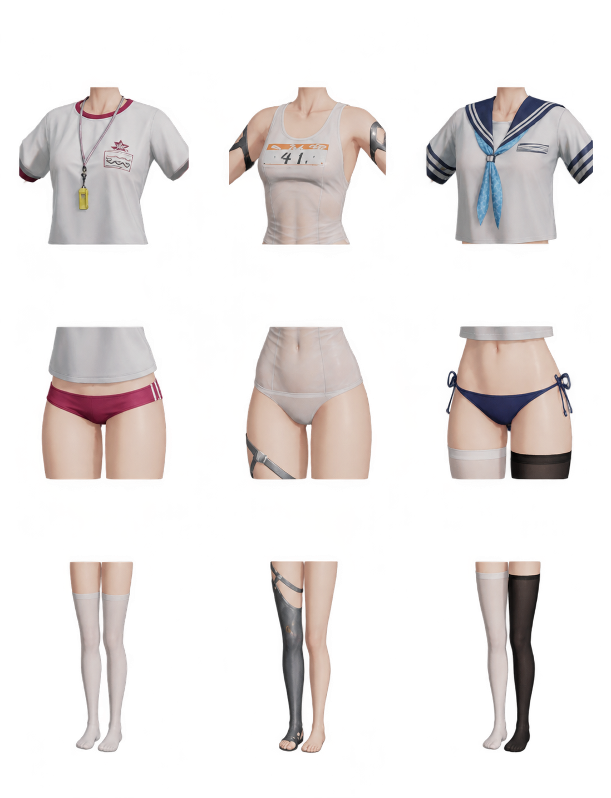

# Faelynn Accessories Randomizer

Picks a Faelynn outfit when you launch GF2. There are 28 combinations, including the default.

[Download for Windows](https://github.com/FateOfMuffins/Faelynn-Accessories-Randomizer/releases/latest/download/Faelynn-Accessories-Randomizer-Setup.exe)



## Setup

Run setup and click **Install**. The overlay appears 30 seconds after GF2 starts. Click it to close.

Open **Faelynn Accessories Randomizer** from the Start menu to change the delay. Settings save automatically. With **Start at sign-in** off, click **Start** before launching GF2.

## Build

```powershell
powershell.exe -ExecutionPolicy Bypass -File .\build.ps1 -Test
```
